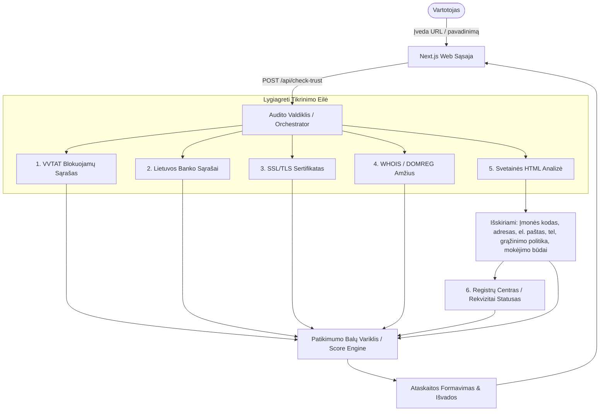

# Sistemos Architektūra (Architecture Specification)

## 1. Technologijų Pasirinkimas (Tech Stack)

* **Karkasas (Framework)**: Next.js 14+ (App Router, TypeScript).
  * *Kodėl*: Pilnas „full-stack“ sprendimas viename projekte – React Server Components greitam vartotojo sąsajos krovimui ir serveriniai API maršrutai (Edge / Node.js runtime) atlikti scrapingą, DNS, WHOIS bei registrų užklausas be CORS apribojimų.
* **Stilius ir UI Komponentai**: Tailwind CSS, Radix UI / Shadcn UI, Lucide Icons.
  * *Kodėl*: Švarus, patikimas, greitas ir modernus dizainas su pasitikėjimą keliančia estetika (Gov / Fintech stilius: švarus baltas/pilkas fonas, aiškūs žali/gintariniai/raudoni saugumo indikatoriai).
* **Inspekcijos ir Scrapingo įrankiai**:
  * `cheerio`: Greitas serverinis HTML analizavimas (reikalingas ištraukti meta duomenis, įmonės kodą, kontaktus, grąžinimo taisykles, mokėjimo būdus).
  * Node.js įmontuoti `tls` ir `https` moduliai: SSL/TLS sertifikato patikrinimui (galiojimo pabaigos data, leidėjas, šifro stiprumas).
  * WHOIS / RDAP klientas (`whois-json` / HTTP RDAP): domeno registracijos datai gauti.
* **Duomenų bazė ir Kešavimas**:
  * SQLite / Turso / Prisma arba lengvas in-memory / JSON kešavimas (MVP etape).
  * Saugo VVTAT blokuojamų domenų sąrašą (atnaujinamą kas 24 valandas) ir anksčiau tikrintų svetainių audito ataskaitas (TTL: 24 val.), kad pakartotinės užklausos veiktų akimirksniu.

---

## 2. Sistemos Komponentų Schema (Component Architecture)



---

## 3. Duomenų Modelis (Data Model & Audit Schema)

```typescript
export interface TrustAuditResult {
  url: string;
  domain: string;
  normalizedDomain: string;
  timestamp: string;
  trustScore: number; // 0 to 100
  trustLevel: 'SAFE' | 'CAUTION' | 'DANGEROUS';
  
  // 1. Oficialūs Blokuojami Sąrašai
  blacklistStatus: {
    isVvtatBlocked: boolean;
    vvtatDetails?: string;
    isLbFlagged: boolean;
    lbDetails?: string;
  };

  // 2. Domeno ir Techniniai Duomenys
  technicalSecurity: {
    hasValidSsl: boolean;
    sslIssuer?: string;
    sslValidUntil?: string;
    domainCreatedDate?: string;
    domainAgeMonths?: number;
    isNewDomain: boolean; // < 3-6 months
  };

  // 3. Juridinis Asmuo ir Rekvizitai
  legalEntity: {
    companyFound: boolean;
    companyCode?: string;
    companyName?: string;
    physicalAddress?: string;
    email?: string;
    phone?: string;
    jarStatus?: 'VEIKIANTI' | 'BANKRUTUOJANTI' | 'LIKVIDUOJAMA' | 'NEZINOMA';
    hasVatCode?: boolean;
    isLithuanianOrEu: boolean;
  };

  // 4. Vartotojų Teisės ir Taisyklės
  consumerProtection: {
    hasReturnPolicy: boolean; // 14 dienų grąžinimo teisė
    hasPrivacyPolicy: boolean;
    paymentMethodsDetected: string[];
    suspiciousIndicators: string[];
  };

  // 5. Išvados ir Rekomendacijos
  recommendations: {
    verdict: string;
    keyPoints: {
      type: 'success' | 'warning' | 'danger' | 'info';
      title: string;
      description: string;
    }[];
    vvtatAdviceLink: string;
  };
}
```

---

## 4. Projekto Katalogų Struktūra (Folder Structure)

```text
eshop-trust-checker/
├── docs/
│   ├── PRD.md
│   ├── ARCHITECTURE.md
│   └── VVTAT_CRITERIA_AND_DATA_SOURCES.md
├── src/
│   ├── app/
│   │   ├── api/
│   │   │   ├── check/
│   │   │   │   └── route.ts         # Pagrindinis audito API endpointas
│   │   │   └── sync-blacklist/
│   │   │       └── route.ts         # VVTAT sąrašo atnaujinimo endpointas
│   │   ├── layout.tsx
│   │   └── page.tsx                 # Pagrindinis puslapis su paieškos lauku
│   ├── components/
│   │   ├── SearchBar.tsx            # URL / pavadinimo įvesties komponentas
│   │   ├── TrustScoreGauge.tsx      # Vaizdinis 0-100 balas ir šviesoforas
│   │   ├── AuditBreakdown.tsx       # Detalių kriterijų kortelės
│   │   ├── LegalSummaryCard.tsx     # Rekvizitų ir JAR informacija
│   │   └── Header.tsx / Footer.tsx
│   ├── lib/
│   │   ├── audit-engine.ts          # Pagrindinis patikros orkestratorius
│   │   ├── vvtat-checker.ts         # VVTAT blokuojamų sąrašo tikrintuvas
│   │   ├── whois-checker.ts         # Domeno amžiaus nustatymas
│   │   ├── ssl-checker.ts           # Sertifikato tikrinimas
│   │   ├── scraper.ts               # HTML analizavimas ir rekvizitų paieška
│   │   └── jar-checker.ts           # Įmonių registrų tikrintuvas
│   └── data/
│       └── vvtat-blocked-cache.json # Lokalios talpyklos kopija
├── package.json
├── tsconfig.json
├── tailwind.config.js
└── README.md
```
