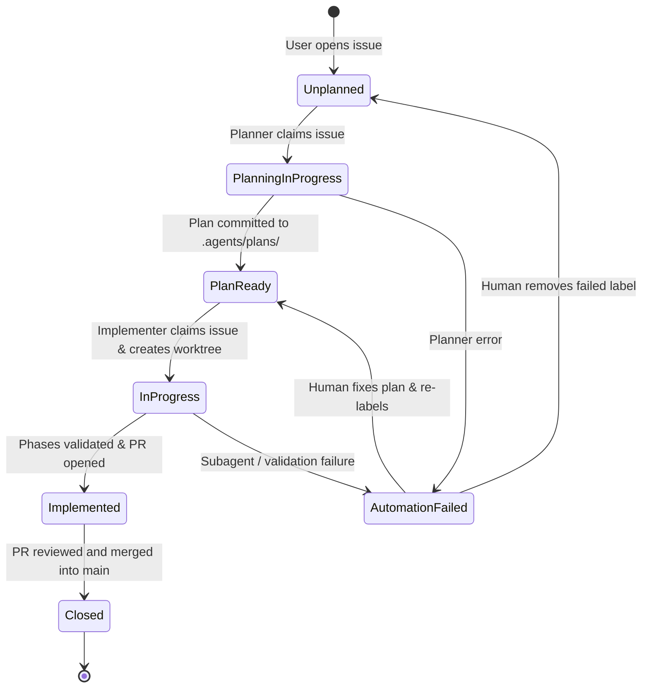

# Autonomous Issue Planning & Implementation Workflow

This document serves as the single source of truth for the autonomous issue lifecycle, scheduling sidecars, label state machines, concurrency guards, and single-PR pipeline policies for `eshop-trust-checker`.

---

## 1. High-Level Architecture & Lifecycle

The automation architecture consists of two cooperative background sidecars operating on scheduled intervals via Antigravity:

1. **`github-issue-implementation-plan-generator`** (Planner): Scans for open unplanned GitHub issues, verifies project constraints and skills, writes an exhaustive implementation plan to `.agents/plans/`, commits and pushes to `main`, and marks the issue `plan-ready`.
2. **`plan-ready-issue-implementer`** (Implementer): Picks the next `plan-ready` issue, sets up an isolated git worktree, executes all plan phases sequentially via dedicated subagents, validates each phase, commits changes, opens a Pull Request on GitHub, and marks the issue `implemented`.

### Issue State Machine

---

## 2. Guardrails & Concurrency Controls

### The Duplicate Run Problem & Root Cause
In earlier iterations, duplicate runs occurred (e.g. two planner sessions within 7 minutes) due to two flaws:
1. **Cron cadence shorter than task duration**: Fixed cadences (e.g. 5m / 11m) triggered a second job before the first finished (planning takes 5–8 minutes; implementation takes 15–25 minutes).
2. **Lack of global and repository-wide guards**: If run 1 was actively planning Issue A, run 2 started, saw Issue B was also open, and began planning Issue B in parallel. This produced overlapping work, git push collisions on `main`, and uncoordinated branch creation.

### Enforced Concurrency Rules

Both automations now follow a strict **Pre-flight Guard Check** executed before performing any work:

| Guard Check | Planner (`plan-generator`) | Implementer (`issue-implementer`) | Rationale |
| :--- | :--- | :--- | :--- |
| **Open PR Check** | **BLOCKS** if any PR is open (`gh pr list --state open`) | **BLOCKS** if any PR is open (`gh pr list --state open`) | Enforces **Single Active PR per repo**. Guarantees new plans and implementations are always grounded in the latest merged code on `main`. |
| **In-Flight Lock Check** | **BLOCKS** if any issue has `planning-in-progress`, `in-progress`, or `plan-ready` | **BLOCKS** if any issue has `in-progress` | Ensures strictly **one issue** is being planned or executed at any time. Prevents duplicate runs and git push race conditions. |
| **Worktree Isolation** | N/A (writes plan directly to `main`) | Creates `worktrees/issue-<NUM>-<slug>` off clean `main` | Ensures working tree is isolated; clean teardown on finish or error. |

---

## 3. Label Catalog (One-Time Setup)

All labels are pre-created in the GitHub repository. **Automations must never attempt to create labels (`gh label create`) or require permissions to create labels.**

| Label | Color | Description | Owner / Transition |
| :--- | :--- | :--- | :--- |
| `ready-for-plan` | `#1d76db` | Optional manual trigger to prioritize an issue for planning. | Human / Issue triage |
| `planning-in-progress` | `#fbca04` | Mutual exclusion lock indicating a plan is being written. | Set by Planner; removed when plan pushed |
| `plan-ready` | `#0e8a16` | Implementation plan committed and ready for execution. | Set by Planner; consumed by Implementer |
| `in-progress` | `#fbca04` | Mutual exclusion lock indicating implementation is underway. | Set by Implementer; removed on PR creation |
| `implemented` | `#0e8a16` | Automated implementation complete; PR opened and linked. | Set by Implementer upon `gh pr create` |
| `automation-failed` | `#d93f0b` | Automated execution encountered an unrecoverable error. | Set by either sidecar on error |

---

## 4. Automation Specifications

### Sidecar 1: GitHub Issue Implementation Plan Generator
- **Location**: `~/.gemini/config/sidecars/github-issue-implementation-plan-generator/sidecar.json`
- **Schedule**: `CRON_TZ=Europe/Vilnius */10 * * * *` (Every 10 minutes)
- **Restart Policy**: `always`
- **Execution Flow**:
  1. **Pre-flight Guard Check**:
     - Check `gh pr list --state open --limit 5`: If any open PR exists, log and exit immediately.
     - Check `gh issue list --state open --search "label:planning-in-progress label:in-progress label:plan-ready" --limit 10`: If any issue is found, log and exit immediately.
  2. **Select Next Issue**:
     - Query open issues excluding `plan-ready`, `planning-in-progress`, `in-progress`, `implemented`, `automation-failed`.
     - Check if `.agents/plans/issue-<number>-*.md` already exists on disk: if so, add `plan-ready` and skip.
     - Select the single oldest issue (favoring `ready-for-plan` if present, else lowest issue number). If none, exit cleanly.
  3. **Claim Issue**:
     - Run `gh issue edit <number> --add-label planning-in-progress`.
  4. **Generate Plan**:
     - Read `piv-plan-implementation/SKILL.md` and `AGENTS.md`.
     - Inspect codebase structure and existing patterns.
     - Write detailed implementation plan to `.agents/plans/issue-<number>-<slug>.md`.
  5. **Commit & Push**:
     - `git add .agents/plans/issue-<number>-<slug>.md`
     - `git commit -m "docs(plan): add implementation plan for issue #<number>"`
     - `git push`
  6. **Release Lock & Announce**:
     - `gh issue edit <number> --add-label plan-ready --remove-label planning-in-progress --remove-label ready-for-plan`
     - Post confirmation comment linking the plan path.

### Sidecar 2: Plan-Ready Issue Auto-Implementer
- **Location**: `~/.gemini/config/sidecars/plan-ready-issue-implementer/sidecar.json`
- **Schedule**: `CRON_TZ=Europe/Vilnius */15 * * * *` (Every 15 minutes)
- **Restart Policy**: `always`
- **Execution Flow**:
  1. **Pre-flight Guard Check**:
     - Check `gh pr list --state open --limit 5`: If any open PR exists, log: *"Open PR detected. Only 1 PR per repo allowed. Awaiting review/merge."* and exit immediately.
     - Check `gh issue list --state open --search "label:in-progress" --limit 5`: If any issue has `in-progress`, log: *"Implementation already in progress. Exiting."* and exit immediately.
  2. **Select Next Issue**:
     - Query open issues with `label:plan-ready -label:in-progress -label:implemented -label:planning-in-progress -label:automation-failed`.
     - Pick the single oldest issue `<NUMBER>`. If none, exit cleanly.
  3. **Claim Issue**:
     - Atomically swap: `gh issue edit <NUMBER> --remove-label "plan-ready" --add-label "in-progress"`.
  4. **Load Plan**:
     - Parse `.agents/plans/issue-<NUMBER>-*.md`. If missing, comment on issue, set `automation-failed`, and abort.
  5. **Prepare Worktree**:
     - `git pull --ff-only` on `main`.
     - Create worktree: `git worktree add worktrees/issue-<NUMBER>-<slug> -b feat/issue-<NUMBER>-<slug> main`.
  6. **Sequential Phase Subagents**:
     - For each Phase 1..N:
       - Launch dedicated subagent in `worktrees/issue-<NUMBER>-<slug>`.
       - Run Phase tasks, execute tests (`npm test`, `npx tsc --noEmit`).
       - Wait for completion before starting the next Phase.
  7. **Commit, Push & Open PR**:
     - Commit in worktree: `git -C worktrees/issue-<NUMBER>-<slug> commit -m "feat: <title> (Closes #<NUMBER>)"`.
     - Push branch to remote: `git -C worktrees/issue-<NUMBER>-<slug> push -u origin feat/issue-<NUMBER>-<slug>`.
     - Open PR: `gh pr create --base main --head feat/issue-<NUMBER>-<slug> --title "feat: <title> (#<NUMBER>)" --body "..."`.
  8. **Complete & Clean Up**:
     - Update issue: `gh issue edit <NUMBER> --remove-label "in-progress" --add-label "implemented"`.
     - Post comment with PR link.
     - Remove worktree: `git worktree remove worktrees/issue-<NUMBER>-<slug> --force`.

---

## 5. Operations & Troubleshooting

### Handling a Failed Run (`automation-failed`)
If a run encounters a compilation or execution failure:
1. The issue is tagged `automation-failed` with an explanatory comment.
2. The worktree is cleaned up automatically.
3. **Recovery**:
   - Inspect the issue comments to see the failure log.
   - Adjust the plan file or codebase directly.
   - Remove `automation-failed` and add `plan-ready` to retry implementation.

### Human Review & Merging PRs
- Once a PR is opened, both automations pause automatically.
- After a human reviews, validates, and merges the PR into `main` (closing the PR), the next scheduled run resumes the pipeline for the next issue.
- If a PR requires manual tweaks, commit to the PR branch directly before merging.

### Access Grants Summary
Neither sidecar requests or requires `command(gh label create)`. All required access grants are strictly scoped to `gh issue`, `gh pr`, `git`, and local filesystem operations.
