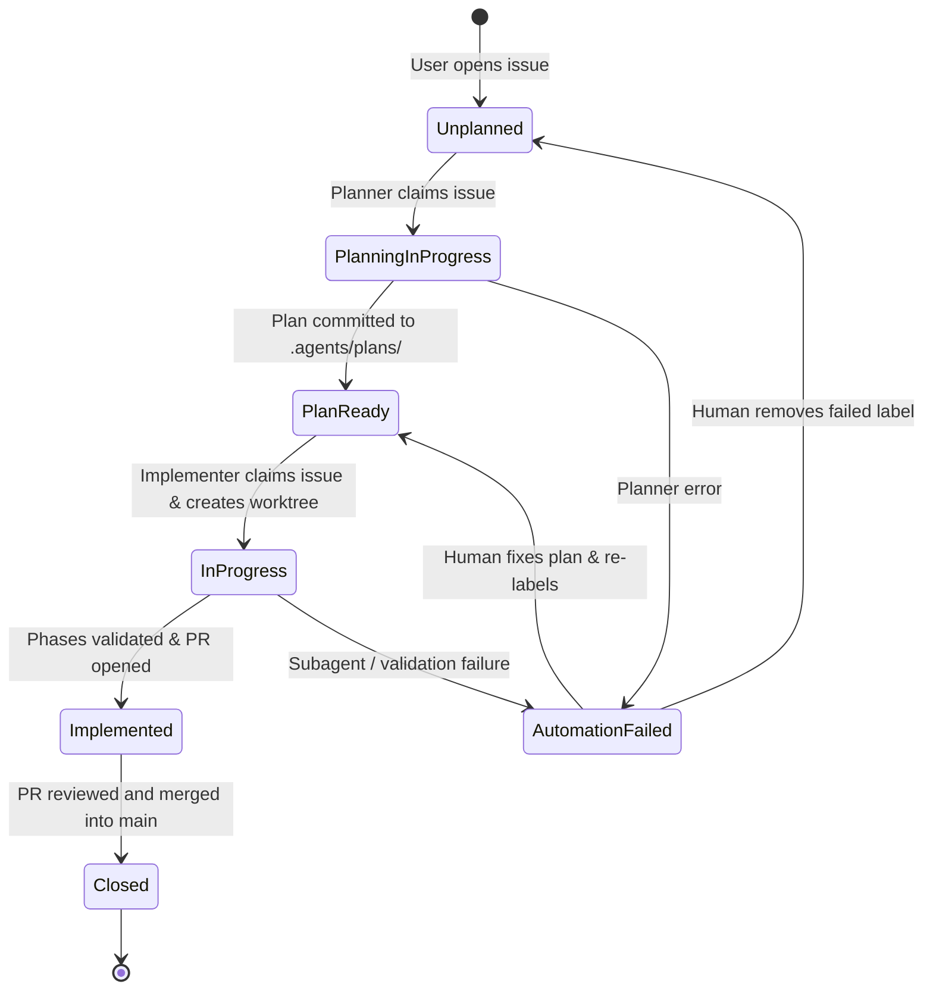

# Autonomous Issue Planning & Implementation Workflow

This document serves as the single source of truth for the autonomous issue lifecycle, scheduling sidecars, label state machines, concurrency guards, and single-PR pipeline policies for `eshop-trust-checker`.

---

## 1. High-Level Architecture & Lifecycle

The automation architecture consists of two cooperative background sidecars operating on scheduled intervals via Antigravity:

1. **`gh-auto-Issue-Plan-Create-For-Implement`** (Planner): Scans for open unplanned GitHub issues, verifies project constraints and skills, writes an exhaustive implementation plan to `.agents/plans/`, commits and pushes to `main`, and marks the issue `plan-ready`.
2. **`gh-auto-Issue-Implement-Plan-Ready`** (Implementer): Picks the next `plan-ready` issue, sets up an isolated git worktree, executes all plan phases sequentially via dedicated subagents, validates each phase, commits changes, opens a Pull Request on GitHub, and marks the issue `implemented`.

### Issue State Machine

---

## 2. Guardrails & Concurrency Controls

### The Duplicate Run Problem & Root Cause
In earlier iterations, duplicate runs occurred (e.g. two planner sessions within 7 minutes) due to two flaws:
1. **Cron cadence shorter than task duration**: Fixed cadences (e.g. 5m / 11m) triggered a second job before the first finished (planning takes 5–8 minutes; implementation takes 15–25 minutes).
2. **Lack of global and repository-wide guards**: If run 1 was actively planning Issue A, run 2 started, saw Issue B was also open, and began planning Issue B in parallel. This produced overlapping work, git push collisions on `main`, and uncoordinated branch creation.

### Enforced Concurrency Rules

Both automations now follow a strict **Pre-flight Guard Check** executed from a single open-PR check and single open-issue JSON snapshot (`--state open --limit 100`, avoiding GitHub `--search` AND-query pitfalls and search-index lag) before performing any work:

| Guard Check | Planner (`plan-generator`) | Implementer (`issue-implementer`) | Rationale |
| :--- | :--- | :--- | :--- |
| **Core 1a: Open PR Check** | **BLOCKS** if any PR is open (`gh pr list --state open`) | **BLOCKS** if any PR is open (`gh pr list --state open`) | Enforces **Single Active PR per repo**, including manual/human PRs that lack issue labels. |
| **Core 1b: Open Issue Lock Check** | **BLOCKS** if any open issue has `automation-failed`, `in-progress`, `planning-in-progress`, or `implemented` | **BLOCKS** if any open issue has `automation-failed`, `in-progress`, `planning-in-progress`, or `implemented` | Pauses the entire pipeline on failures or active/implemented open work (scoped to `--state open` so closed issues do not block). |
| **Core 2: `plan-ready` Queue Check** | **BLOCKS** if any open issue already has `plan-ready` | **REQUIRES** at least one open issue with `plan-ready` (exits cleanly if none) | Prevents planning ahead/drift while allowing Implementer to consume the single `plan-ready` issue. |
| **Worktree Isolation** | N/A (writes plan directly to `main`) | Creates `worktrees/issue-<NUM>-<slug>` off clean `main` (`-B` resets stale local branches) | Ensures working tree is isolated; clean teardown on finish or error. |

---

## 3. Label Catalog (One-Time Setup)

All labels are pre-created in the GitHub repository. **Automations must never attempt to create labels (`gh label create`) or require permissions to create labels.**

| Label | Color | Description | Owner / Transition |
| :--- | :--- | :--- | :--- |
| `ready-for-plan` | `#1d76db` | Optional manual trigger to prioritize an issue for planning. | Human / Issue triage |
| `planning-in-progress` | `#fbca04` | Mutual exclusion lock indicating a plan is being written. | Set by Planner; removed when plan pushed |
| `plan-ready` | `#0e8a16` | Implementation plan committed and ready for execution. | Set by Planner; consumed by Implementer |
| `in-progress` | `#fbca04` | Mutual exclusion lock indicating implementation is underway. | Set by Implementer; removed on PR creation |
| `implemented` | `#0e8a16` | Automated implementation complete; PR opened and linked. | Set by Implementer upon `gh pr create` |
| `automation-failed` | `#d93f0b` | Automated execution encountered an unrecoverable error. | Set by either sidecar on error |

---

## 4. Automation Specifications

### Sidecar 1: `gh-auto-Issue-Plan-Create-For-Implement`
- **Sidecar ID / Folder**: `github-issue-implementation-plan-generator` (`display_name`: `gh-auto-Issue-Plan-Create-For-Implement`)
- **Location**: `~/.gemini/config/sidecars/github-issue-implementation-plan-generator/sidecar.json`
- **Model**: `gemini-4-hydrogen-xhigh`
- **Schedule**: `CRON_TZ=Europe/Vilnius */10 * * * *` (Every 10 minutes)
- **Restart Policy**: `always`
- **Execution Flow**:
  1. **Pre-flight Guard Check (Core 1 + Core 2)**:
     - Check `gh pr list --state open --json number,title,url --limit 10`: If any open PR exists, exit immediately.
     - Fetch `gh issue list --state open --limit 100 --json number,title,labels,createdAt,body,url`:
       - **Core 1b**: If any open issue has `automation-failed`, `in-progress`, `planning-in-progress`, or `implemented`, exit immediately.
       - **Core 2**: If any open issue already has `plan-ready`, exit immediately.
  2. **Select Next Issue**:
     - Pick the single oldest open issue from the Step 1 snapshot (favoring `ready-for-plan` if present, else lowest issue number). If none, exit cleanly.
     - Run `git ls-files .agents/plans`: if `.agents/plans/issue-<number>-*.md` already exists on disk, add `plan-ready` (removing `ready-for-plan`) and exit immediately.
  3. **Claim Issue Early**:
     - Immediately run `gh issue edit <number> --add-label "planning-in-progress"` before reading skills or inspecting the codebase.
  4. **Sync Main & Generate Plan**:
     - `git pull --ff-only` on `main`.
     - Read `piv-plan-implementation/SKILL.md` and `AGENTS.md`.
     - Inspect codebase structure and write `.agents/plans/issue-<number>-<slug>.md`.
  5. **Commit & Push**:
     - `git add .agents/plans/issue-<number>-<slug>.md` and `git commit -m "docs(plan): add implementation plan for issue #<number>"` (sandboxed, separate commands).
     - `git push` (`BypassSandbox: true`). On failure, swap `planning-in-progress` to `automation-failed` and post a plain single-line comment.
  6. **Release Lock & Announce**:
     - `gh issue edit <number> --add-label "plan-ready" --remove-label "planning-in-progress" --remove-label "ready-for-plan"`
     - Post plain single-line confirmation comment (no backticks, `$`, or chaining).

### Sidecar 2: `gh-auto-Issue-Implement-Plan-Ready`
- **Sidecar ID / Folder**: `plan-ready-issue-implementer` (`display_name`: `gh-auto-Issue-Implement-Plan-Ready`)
- **Location**: `~/.gemini/config/sidecars/plan-ready-issue-implementer/sidecar.json`
- **Model**: `gemini-4-hydrogen-high`
- **Schedule**: `CRON_TZ=Europe/Vilnius */15 * * * *` (Every 15 minutes)
- **Restart Policy**: `always`
- **Execution Flow**:
  1. **Pre-flight Guard Check (Core 1 + Core 2)**:
     - Check `gh pr list --state open --json number,title,url --limit 10`: If any open PR exists, exit immediately.
     - Fetch `gh issue list --state open --limit 100 --json number,title,url,createdAt,labels,body,comments`:
       - **Core 1b**: If any open issue has `automation-failed`, `in-progress`, `planning-in-progress`, or `implemented`, exit immediately.
       - **Core 2**: Filter the snapshot for `plan-ready`. If no open issue has `plan-ready`, exit cleanly. Pick the single oldest `plan-ready` issue `<NUMBER>`.
  2. **Claim Issue Early**:
     - Immediately swap `gh issue edit <NUMBER> --remove-label "plan-ready" --add-label "in-progress"` before reading `AGENTS.md`, plan files, or pulling `main`.
  3. **Sync Main & Load Plan**:
     - `git pull --ff-only` on `main`, read `AGENTS.md`, and parse `.agents/plans/issue-<NUMBER>-*.md`. If missing, post plain-text comment, swap `in-progress` to `automation-failed`, and abort.
  4. **Prepare Worktree**:
     - In sandbox: `git worktree prune` and `git worktree add -B feat/issue-<NUMBER>-<slug> worktrees/issue-<NUMBER>-<slug> main`.
  5. **Sequential Phase Subagents**:
     - For each Phase 1..N:
       - Launch dedicated `self` subagent in `worktrees/issue-<NUMBER>-<slug>`.
       - Run Phase tasks and tests (`npx tsc --noEmit`, `npm test`) in sandbox; wait for completion before Phase K+1.
       - On failure, write details to `worktrees/issue-<NUMBER>-<slug>/.gh-fail-body.md`, post via `gh issue comment <NUMBER> --body-file ...`, swap `in-progress` to `automation-failed`, remove worktree `--force`, and stop.
  6. **Commit, Push & Open PR**:
     - Stage & commit in sandbox: `git -C worktrees/issue-<NUMBER>-<slug> add -A` and `git -C worktrees/issue-<NUMBER>-<slug> commit -m "feat: <sanitized summary> (Closes #<NUMBER>)"`.
     - Push from main workspace root with `BypassSandbox: true` (no `-C` flag): `git push -u origin feat/issue-<NUMBER>-<slug>`.
     - Write PR body to `worktrees/issue-<NUMBER>-<slug>/.gh-pr-body.md` and run `gh pr create --base main --head feat/issue-<NUMBER>-<slug> --title "feat: <sanitized title> (#<NUMBER>)" --body-file worktrees/issue-<NUMBER>-<slug>/.gh-pr-body.md`.
  7. **Complete & Clean Up**:
     - `gh issue edit <NUMBER> --remove-label "in-progress" --add-label "implemented"`.
     - Write comment to `worktrees/issue-<NUMBER>-<slug>/.gh-done-body.md` and run `gh issue comment <NUMBER> --body-file ...`.
     - Remove worktree in sandbox: `git worktree remove worktrees/issue-<NUMBER>-<slug> --force`.

---

## 5. Operations & Troubleshooting

### Handling a Failed Run (`automation-failed`)
If a run encounters a compilation or execution failure:
1. The issue is tagged `automation-failed` with an explanatory comment.
2. The worktree is cleaned up automatically.
3. **Recovery**:
   - Inspect the issue comments to see the failure log.
   - Adjust the plan file or codebase directly.
   - Remove `automation-failed` and add `plan-ready` to retry implementation.

### Human Review & Merging PRs
- Once a PR is opened, both automations pause automatically.
- After a human reviews, validates, and merges the PR into `main` (closing the PR), the next scheduled run resumes the pipeline for the next issue.
- If a PR requires manual tweaks, commit to the PR branch directly before merging.

### Access Grants Summary
Neither sidecar requests or requires `command(gh label create)`. All required access grants are strictly scoped to `gh issue`, `gh pr`, `git`, and local filesystem operations.
